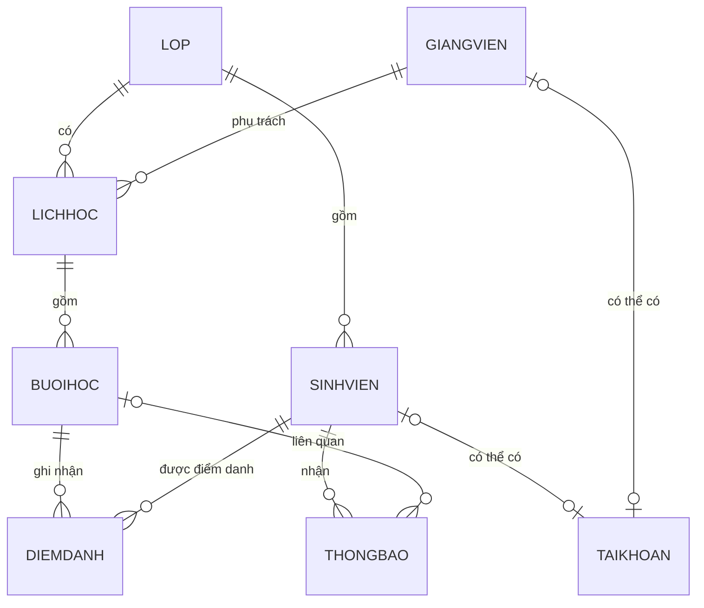

# Quan hệ CSDL – sơ đồ ERD 8 bảng của phiên bản minh họa

Các quan hệ một–nhiều: `LOP` → `SINHVIEN`, `LOP` → `LICHHOC`, `GIANGVIEN` → `LICHHOC`, `LICHHOC` → `BUOIHOC`, `BUOIHOC` → `DIEMDANH`, `SINHVIEN` → `DIEMDANH`, `SINHVIEN` → `THONGBAO`, `BUOIHOC` → `THONGBAO`. Bảng `TAIKHOAN` có liên kết tùy chọn một–một đến SINHVIEN hoặc GIANGVIEN.

**Lưu ý:** MySQL bảo đảm PK/FK/UNIQUE. Quy tắc "sinh viên phải thuộc lớp của buổi học" còn được kiểm tra tại `attendance.php`, vì hai khóa ngoại riêng không bảo đảm được ràng buộc này.
